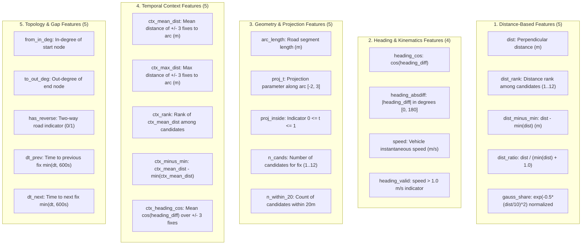

# PathSnap Module 1 (M1) Technical Documentation
**Problem Framing, Dataset Understanding, Label Alignment & Feature Engineering**

---

## 1. Problem Statement & Mathematical Formulation

### 1.1 The GPS Map-Matching Problem
Given a sequence of discrete, time-stamped, and noisy GPS observations collected from a vehicle:
$$\mathcal{T} = \{(lon_i, lat_i, t_i)\}_{i=1}^N$$
and a directed road network represented as a graph:
$$G = (V, E)$$
where $V$ is a set of road intersections/junctions and $E \subseteq V \times V$ is a set of directed road segments (arcs), the goal of map matching is to reconstruct the true sequence of road segments $\mathcal{R}^* = (a_1^*, a_2^*, \dots, a_M^*)$ with $a_k^* \in E$ actually traversed by the vehicle, and to identify the specific arc $a^*(i) \in E$ corresponding to each GPS observation $i$.

### 1.2 Core Challenges
1. **Sensor Measurement Noise:** Multipath effects, satellite geometry, and urban canyons create GPS position errors typically ranging from $\pm 5\text{ m}$ to $\pm 30\text{ m}$.
2. **Topological Ambiguity (Two-Way Roads):** Over **92.2%** of road segments in the network possess reverse twins (bidirectional roads). Opposite-direction lanes are separated by mere metres; simple Euclidean nearest-neighbour matching selects the wrong direction of travel **~45% of the time**.
3. **Discrete Temporal Gaps:** GPS fixes are nominally sampled at 1 Hz, but real-world recordings exhibit signal dropouts, tunnels, and irregular gaps ranging up to hours.
4. **Network Complexity:** Urban road networks contain complex junctions, bifurcations, parallel service roads, and multi-level overpasses where multiple candidate segments share near-identical 2D distance.

### 1.3 System Architecture
PathSnap solves this problem through a robust two-stage pipeline:
1. **Stage 1 (M1 & M2): Candidate Generation & Feature Classification**
   - Spatial candidate indexing identifies all candidate road segments within $50\text{ m}$ of each GPS fix (up to 12 candidates).
   - A 24-dimensional feature vector is extracted for each (fix, candidate) pair.
   - A candidate classifier (tuned LightGBM) computes $P(\text{arc } a \text{ is correct} \mid \text{fix } i)$.
2. **Stage 2 (M3 & M4): Hidden Markov Model (HMM) & Viterbi Decoding**
   - The classifier probabilities serve as emission likelihoods.
   - Transition probabilities are governed by network routing distances computed via bounded Dijkstra search.
   - Viterbi decoding enforces physical route continuity and outputs the drivable path.

---

## 2. Dataset Structure & Partitioning

### 2.1 File Formats
Each trip is stored in an independent directory named by its 8-digit trip identifier (e.g., `00000001/`) containing 4 plain-text space-delimited files:

| File Extension | Dimensions | Columns / Types | Description |
|---|---|---|---|
| `.track` | $N \times 3$ | `lon` (float), `lat` (float), `t` (float) | Raw GPS trajectory points sampled nominally at 1 Hz; timestamps in seconds. |
| `.nodes` | $V \times 2$ | `lon` (float), `lat` (float) | Road network vertices. The 0-indexed row number corresponds to the Node ID. |
| `.arcs` | $E \times 2$ | `from_node` (int), `to_node` (int) | Directed road edges. The 0-indexed row number corresponds to the Arc ID. |
| `.route` | $M \times 1$ | `arc_id` (int) | Ground truth sequence of traversed arc IDs in chronological order. |

> [!IMPORTANT]
> In all dataset files, the horizontal coordinate order is strictly **`longitude` first, `latitude` second**.

### 2.2 Dataset Partitions & Leakage Safeguards
The dataset is partitioned into three distinct sets:
1. **Training Partition (`train/` - 80 trips, 208,417 fixes):** Used exclusively for exploratory data analysis, feature engineering, and 5-fold cross-validation.
2. **Student Testing Partition (`student_test/` - 10 trips, 19,160 fixes):** Used to evaluate out-of-sample generalization.
3. **Evaluator Testing Partition (`evaluator_test/` - 10 trips):** Held-out blind evaluation dataset.

**Data Leakage Safeguards:**
- Cross-validation uses **`GroupKFold(n_splits=5)` grouped by `trip_id`**. Consecutive 1 Hz GPS fixes are highly autocorrelated; a standard random split would place adjacent points from the same trip into both train and test folds, artificially inflating validation performance.
- In inference/prediction mode, `load_trip(trip_dir, with_route=False)` strictly suppresses the loading of `.route`. Feature extraction and model scoring never have access to ground truth.

---

## 3. Data Preprocessing & Metric Projection

### 3.1 Cleaning Pipeline (`pathsnap.data_io.clean_track`)
Raw GPS logs are processed through four validation steps:
1. **Coordinate Feasibility:** Coordinates must be finite and satisfy $|\text{lon}| \le 180^\circ$, $|\text{lat}| \le 90^\circ$, and $(\text{lon}, \text{lat}) \neq (0, 0)$.
2. **Temporal Sorting:** Observations are stably sorted by timestamp $t$.
3. **Duplicate Timestamp Resolution:** Consecutive observations with identical timestamps ($\Delta t = 0$) are dropped to guarantee strict temporal progression.
4. **Audit Metrics:** The cleaning function records raw count, invalid dropped, out-of-order count, and clean count.

### 3.2 Local Equirectangular Projection (`pathsnap.geo.LocalProjection`)
Raw GPS coordinates are angular degrees $(\lambda, \phi)$. Using Euclidean distance on spherical coordinates introduces severe latitude-dependent metric distortion:
$$\Delta x \propto \cos(\phi) \Delta \lambda, \quad \Delta y \propto \Delta \phi$$
To enable fast vectorised metric calculations, each trip is projected onto a local Euclidean metric plane centred on the trip median coordinates $(\lambda_0, \phi_0)$:
$$x = (\lambda - \lambda_0) \cdot \frac{\pi}{180} R \cos(\phi_0)$$
$$y = (\phi - \phi_0) \cdot \frac{\pi}{180} R$$
where $R = 6,371,008.8\text{ m}$ (Earth mean radius).

**Geometric Accuracy:** Over the typical trip diameter of $10\text{--}30\text{ km}$, the scale distortion of this projection is less than **0.05%**—orders of magnitude below the physical noise of commercial GPS (~3–10 m)—while avoiding the computational overhead of heavy GIS projection libraries.

---

## 4. Road Network Representation & Graph Algorithms

The road network is encapsulated by the `RoadNetwork` class (`pathsnap.network`):
1. **Geometric Representation:** Segment start points $p_0$ and end points $p_1$ are stored as metric 2D vectors. Segment lengths $L = \|p_1 - p_0\|_2$ and bearings $\theta = \operatorname{atan2}(\Delta x, \Delta y)$ (clockwise from North) are precomputed.
2. **Spatial Index:** Network arcs are indexed using `shapely.STRtree`, an R-tree using the Sort-Tile-Recursive algorithm, enabling sub-millisecond range and nearest-neighbour spatial queries.
3. **Topology & Adjacency:** Directed connections are represented in Compressed Sparse Row (CSR) format for fast vertex-neighbour lookup.
4. **Bidirectional Detection:** A fast integer hash `rev = to_node * N + from_node` detects whether an arc has an opposite-direction twin (`has_reverse`).
5. **Point-to-Arc Orthogonal Projection:**
   For a point $p$ and segment $p_0 \to p_1$:
   $$t = \frac{(p - p_0) \cdot (p_1 - p_0)}{\|p_1 - p_0\|^2}, \quad t_c = \operatorname{clip}(t, 0, 1)$$
   $$\text{foot} = p_0 + t_c (p_1 - p_0), \quad \text{dist} = \|p - \text{foot}\|_2$$
6. **Bounded Dijkstra Shortest Paths:** Network distances between nodes are computed using bounded Dijkstra search with caching, terminating once the search radius exceeds a distance threshold.

---

## 5. Label Generation: Monotone Dynamic Programming

### 5.1 Alignment Formulation
The `.route` file contains a chronological list of traversed arcs $[r_1, r_2, \dots, r_M]$, but does not specify which GPS fix corresponds to which arc.
To assign an arc label to each GPS observation $i \in \{0, \dots, N-1\}$, we formulate a **monotone dynamic programming alignment** (`pathsnap.labeling.align_to_route`):
- Let $j \in \{0, \dots, M-1\}$ denote an index into the reference route.
- Let $c(i, j) = \text{dist}(p_i, \text{arc}_{r_j})$ be the orthogonal distance from GPS fix $i$ to route arc $r_j$.
- Since time flows monotonically forward, route position must be non-decreasing: $j(i) \ge j(i-1)$.

The dynamic programming recurrence is:
$$D(0, j) = c(0, j)$$
$$D(i, j) = c(i, j) + \min_{0 \le k \le j} D(i-1, k) \quad \text{for } i \ge 1$$

Using prefix minimums:
$$\operatorname{best}(j) = \min_{0 \le k \le j} D(i-1, k)$$
each step is computed in $O(M)$ time, resulting in an overall time complexity of $O(N \cdot M)$. Backtracking from $\operatorname{argmin}_j D(N-1, j)$ produces the optimal sequence of route assignments.

### 5.2 Unreliable Label Filtering
In cases where GPS tracking continues while the reference route is not active (or during massive GPS anomalies), the aligned distance $c(i, j(i))$ can be very large.
Fixes with:
$$\text{ref\_dist} > \text{LABEL\_MAX\_DIST\_M} = 100.0\text{ m}$$
are flagged as **unreliable** (`reliable = False`). Unreliable fixes are excluded from model training loss and metric scoring. This occurs predominantly in trips `00000054` and `00000033`, where the reference route ends well before the recorded GPS track.

---

## 6. Candidate Road Segment Generation

For each observation $i$:
1. **Spatial Search Radius:** The spatial index queries all arcs within $r = 50.0\text{ m}$ (`predicate="dwithin"`).
2. **Candidate Limit:** Candidates are sorted by perpendicular distance, retaining at most $K = 12$ nearest candidates per fix.
3. **Outlier Fallback:** If zero arcs fall within the $50\text{ m}$ search radius (e.g. during a GPS jump or in sparse areas), the system queries the single nearest arc, measures its distance $d_0$, and expands search to $d_0 + 30\text{ m}$, retaining the 3 nearest arcs (`CAND_FALLBACK_K = 3`).

**Empirical Candidate Coverage:**
- Training Set: **98.60%** candidate hit rate (**1.40%** candidate miss rate).
- Student Testing Set: **99.88%** candidate hit rate (**0.12%** candidate miss rate).

---

## 7. The 24 Engineered Features

Every sample in the training/inference matrix represents a `(GPS fix i, candidate arc a)` pair. All 24 features are strictly numerical, deterministic, and free of missing values.



### Detailed Feature Group Breakdown

| # | Feature Name | Group | Formula / Definition | Technical Motivation |
|---|---|---|---|---|
| 1 | `dist` | Distance | $\|p_i - \text{foot}_{i,a}\|_2$ (metres) | Primary spatial proximity indicator. |
| 2 | `dist_rank` | Distance | $\operatorname{rank}(\text{dist}_{i, a})$ across candidates of fix $i$ | Invariant to absolute GPS drift; relative closeness. |
| 3 | `dist_minus_min` | Distance | $\text{dist}_{i, a} - \min_{k} \text{dist}_{i, k}$ | Distance penalty relative to closest candidate. |
| 4 | `dist_ratio` | Distance | $\text{dist}_{i, a} / (\min_{k} \text{dist}_{i, k} + 1.0)$ | Scale-independent proximity ratio. |
| 5 | `gauss_share` | Distance | $\frac{\exp(-0.5(\text{dist}/10)^2)}{\sum_k \exp(-0.5(\text{dist}_k/10)^2) + \epsilon}$ | Softmax Gaussian emission prior ($\sigma = 10\text{ m}$). |
| 6 | `heading_cos` | Heading | $\cos(|\theta_{\text{GPS}} - \theta_{\text{arc}}|)$ | Discriminates forward vs reverse lanes on 2-way roads. |
| 7 | `heading_absdiff`| Heading | $|\theta_{\text{GPS}} - \theta_{\text{arc}}| \in [0^\circ, 180^\circ]$ | Linear angular difference penalty. |
| 8 | `speed` | Heading | $\|p_{i+1} - p_{i-1}\|_2 / (t_{i+1} - t_{i-1})$ | Central-difference speed ($m/s$). |
| 9 | `heading_valid` | Heading | $\mathbb{I}(\text{speed} > 1.0\text{ m/s})$ | Flags when vehicle is moving; stationary heading is noise. |
| 10 | `arc_length` | Geometry | Length of arc in metres | Distinguishes short intersection connectors from long roads. |
| 11 | `proj_t` | Geometry | Unclipped projection parameter $t \in [-2, 3]$ | Indicates where along the road line the fix projects. |
| 12 | `proj_inside` | Geometry | $\mathbb{I}(0 \le t \le 1)$ | 1 if perpendicular projection lands on segment, 0 if past endpoints. |
| 13 | `n_cands` | Geometry | Total candidates generated for fix $i$ | Local network density proxy (sparse vs dense junction). |
| 14 | `n_within_20` | Geometry | Count of candidates with $\text{dist} \le 20\text{ m}$ | Local competitor ambiguity indicator. |
| 15 | `ctx_mean_dist` | Context | $\frac{1}{7} \sum_{k=-3}^3 \text{dist}(p_{i+k}, a)$ | Temporal smoothing: true road explains neighbouring fixes. |
| 16 | `ctx_max_dist` | Context | $\max_{k \in [-3, 3]} \text{dist}(p_{i+k}, a)$ | Rejects candidate if vehicle turns away within 3 seconds. |
| 17 | `ctx_rank` | Context | Rank of `ctx_mean_dist` among candidates | Relative temporal support rank. |
| 18 | `ctx_minus_min` | Context | $\text{ctx\_mean\_dist} - \min_k \text{ctx\_mean\_dist}$ | Context distance deficit compared to best candidate. |
| 19 | `ctx_heading_cos`| Context| $\frac{1}{6} \sum_{k \neq 0} \cos(\Delta\theta_{i+k}) \cdot \mathbb{I}(\text{speed}_{i+k} > 1)$ | Multi-second heading consensus. |
| 20 | `from_in_deg` | Topology | In-degree of start node | Junction complexity entering the segment. |
| 21 | `to_out_deg` | Topology | Out-degree of end node | Number of exit options at upcoming junction. |
| 22 | `has_reverse` | Topology | $\mathbb{I}(\text{arc } b \to a \in E)$ | Binary flag: two-way road (high risk of lane ambiguity). |
| 23 | `dt_prev` | Topology | $\min(t_i - t_{i-1}, 600.0)$ | Elapsed time since previous GPS observation. |
| 24 | `dt_next` | Topology | $\min(t_{i+1} - t_i, 600.0)$ | Elapsed time to next GPS observation. |

---

## 8. Exploratory Data Analysis & Empirical Findings

### 8.1 Dataset Inventory Summary

| Metric | Training Partition (`train`) | Student Testing (`student_test`) |
|---|---|---|
| Total Trips | 80 trips | 10 trips |
| Total GPS Observations | 208,417 fixes | 19,160 fixes |
| Fixes per Trip (Mean ± SD) | 2,605.2 ± 3,312.3 | 1,916.0 ± 1,335.4 |
| Fixes per Trip (Min / Max) | 361 / 19,313 fixes | 262 / 3,958 fixes |
| NaN / Corrupted Values | **0** (100% clean) | **0** (100% clean) |
| Invalid / Out-of-bounds Points | **0** | **0** |
| Duplicate Timestamps | **0** | **0** |
| Sampling Rate ($\Delta t = 1\text{ s}$) | 93.8% of intervals | 98.2% of intervals |
| Trips with Gaps $> 30\text{ s}$ | 28 trips (max gap: 42.5 hours) | 2 trips (max gap: 210 s) |
| Road Network Nodes (Median) | 9,608 nodes | 6,596.5 nodes |
| Road Network Arcs (Median) | 19,526.5 arcs (max: 307,392) | 13,145 arcs (max: 56,027) |
| Bidirectional Arcs (`has_reverse`) | **92.2%** | **92.7%** |
| Route Continuity | **99.93%** physically drivable | **99.97%** physically drivable |
| Label Reliability ($\le 100\text{ m}$) | **90.15%** | **99.91%** |
| Candidate Miss Rate | **1.40%** | **0.12%** |

### 8.2 Key Visualisations Generated

1. `results/figures/eda_sampling.png`:
   - Histogram of GPS sampling intervals $\Delta t$. Shows tight peak at 1.0 s with a long tail of irregular dropouts.
   - Bar chart of maximum time gaps per training trip. Highlights extreme gaps (up to 153,064 s in trip `00000002`).
2. `results/figures/eda_gps_noise.png`:
   - Distribution of GPS-to-aligned-route distances, marking the $50\text{ m}$ candidate radius and $100\text{ m}$ reliability cutoff.
   - Per-trip reliability fraction showing that 78 out of 80 trips have $>98\%$ reliability, with only trips `00000054` and `00000033` exhibiting large route truncations.
3. `results/figures/eda_locations_network.png`:
   - Geographic distribution of trip centroids across global coordinates.
   - Network node count vs directed arc count scaling logarithmically.
4. `results/figures/eda_trajectories.png`:
   - Trajectory maps comparing raw GPS points (blue), reference route (green), and extracted road network (grey) for trips `00000003` and `00000002`.
5. `results/figures/eda_connectivity.png`:
   - Weakly connected component distribution per trip excerpt.
6. `results/figures/eda_missing_values.png`:
   - Matrix table confirming zero NaN values, zero duplicate timestamps, and zero invalid points.

### 8.3 Interactive Geographical Maps
Interactive Folium Leaflet maps are compiled to HTML in `results/maps/`:
- `results/maps/eda_train_00000003.html`: Clean urban trajectory with dense road network, raw GPS points, and reference route with interactive layer controls.
- `results/maps/eda_train_00000002_anomaly.html`: Trajectory displaying long temporal gap and route geometry anomaly.

---

## 9. Assumptions and Limitations

1. **Local Metric Approximation:** The equirectangular projection assumes a flat-plane approximation around each trip's median coordinate. While valid for single trips under $50\text{ km}$ ($<0.1\%$ distortion), it should not be applied globally across continental distances without re-centering.
2. **Kinematic Speed Estimation:** Instantaneous speed is estimated via central difference over adjacent fixes. Rapid multi-second stops followed by sharp acceleration may yield smoothed speed transitions.
3. **Directed Graph Strictness:** Road networks are assumed to strictly govern legal vehicular travel. Off-road driving, unmapped parking lots, and construction detours will trigger candidate fallbacks.
4. **Candidate Radius Bound:** The $50\text{ m}$ search radius captures $98.6\%$ of true segments. In extreme GPS drift ($>50\text{ m}$), the fallback mechanism queries the nearest segment, but severe multi-hundred-metre jumps are flagged as unreliable.

---

## 10. Verification and Test Suite

A comprehensive test suite is provided in `tests/test_m1.py`:
- Test 1: Module and package imports.
- Test 2: Data loading across all 80 train and 10 student-test trips.
- Test 3: Local projection forward, inverse, and haversine relative error.
- Test 4: Road network construction, CSR adjacency, STRtree, and Dijkstra paths.
- Test 5: Monotone dynamic programming label alignment.
- Test 6: Candidate generation and outlier fallback.
- Test 7: All 24 engineered features (integrity and zero NaN/inf check).
- Test 8: Dataset table construction and candidate hit rates.
- Test 9: Student-test partition compatibility and route leakage safeguards.

Run the test suite with:
```bash
python tests/test_m1.py
```
