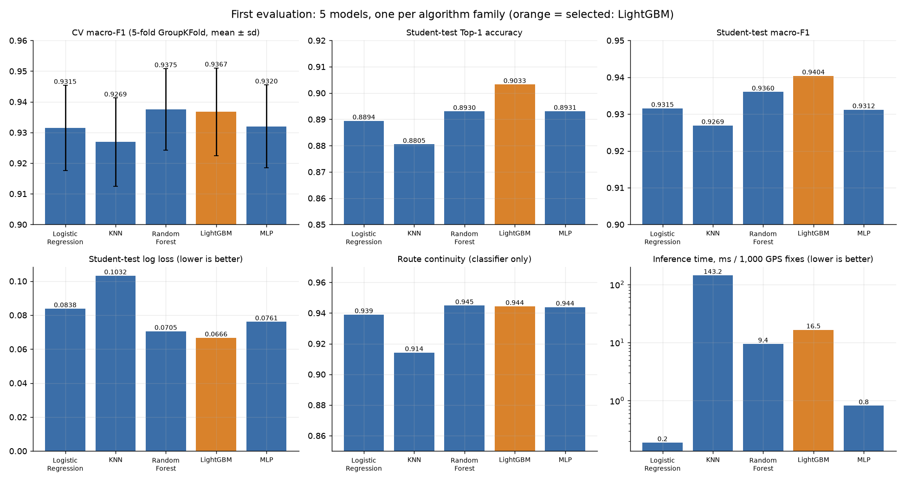
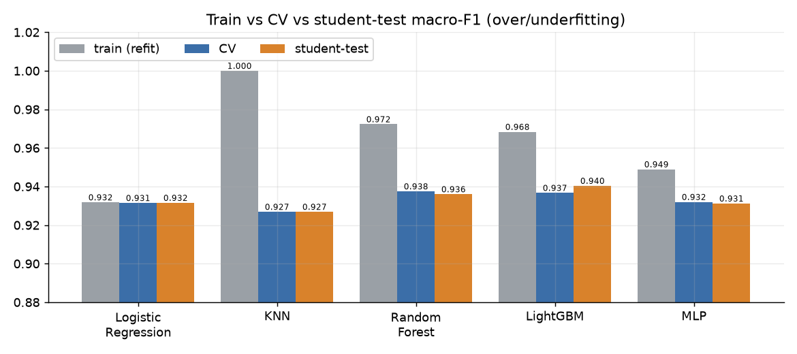

# First evaluation: 5 models and the best one

**Goal of this evaluation:** show 5 trained models and justify picking the best one from experimental evidence.
We trained 8 models in total. For this evaluation we present the **5 below, one from each algorithm family**. The other 3 (Gaussian NB, Decision Tree, XGBoost) are backup, in case evaluators ask "what else did you try?".

All numbers come from `results/model_comparison.csv`, produced by `scripts/train_models.py`.

## The 5 models

| # | Model | Family | Key configuration | CV Macro F1 (mean ± sd) | Student-test Top-1 | Student-test Macro F1 | Log loss | Route continuity | Inference (ms / 1k fixes) |
|---|---|---|---|---|---|---|---|---|---|
| 1 | Logistic Regression | Linear | L2, C=1.0, standardised | 0.9315 ± 0.0139 | 0.8894 | 0.9315 | 0.0838 | 0.939 | 0.2 |
| 2 | KNN | Instance-based | k=25, distance-weighted, 60k reference rows | 0.9269 ± 0.0144 | 0.8805 | 0.9269 | 0.1032 | 0.914 | 143.2 |
| 3 | Random Forest | Ensemble (bagging) | 150 trees, min_samples_leaf=5 | **0.9375** ± 0.0133 | 0.8930 | 0.9360 | 0.0705 | **0.945** | 9.4 |
| 4 | **LightGBM** ✅ | Boosting | 400 trees, lr=0.05, 63 leaves | 0.9367 ± 0.0143 | **0.9033** | **0.9404** | **0.0666** | 0.944 | 16.5 |
| 5 | MLP | Neural network | 64-32 ReLU, Adam, early stopping | 0.9320 ± 0.0135 | 0.8931 | 0.9312 | 0.0761 | 0.944 | 0.8 |

- **Protocol:** 5-fold GroupKFold over the 80 training trips (a trip never appears in two folds). Each model is then refit on all 80 trips and tested on the 10 student-test trips.
- **Task:** for every (GPS fix, candidate road arc) pair, predict P(this arc is the true one). Top-1 picks the highest-probability arc per fix.
- **Primary selection metric:** Top-1 accuracy, which is the actual route-matching objective, together with log loss. Log loss matters because the probabilities become the HMM's emission scores.

## Why LightGBM is the best (the answer to "why not Random Forest?")

1. **Best student-test Top-1** (0.9033) and **best Macro F1** (0.9404) of all 5.
2. **Best log loss** (0.0666), so it gives the best-calibrated probabilities to feed into the HMM/Viterbi decoder.
3. **CV is a tie between the ensembles.** Random Forest's CV F1 is 0.0008 higher, but the fold standard deviation is ~0.014, about 17× larger, so that difference is noise.
4. **Practical:** it trains in seconds, has a much smaller artifact than Random Forest, and offers more hyperparameters worth tuning. That makes it the right candidate for Bayesian optimisation, the next stage.

Why the other models lost:
- **Logistic Regression** is linear, so it cannot model interactions such as "heading only matters when the vehicle is moving". Its train F1 equals its test F1 (0.93), which means it underfits.
- **KNN** memorises: train F1 = 1.000 vs test 0.927 (overfitting). It is also about 10× slower at inference than every other model (143 ms per 1k fixes).
- **MLP** is decent, but on tabular data with thresholds (ranks, degrees) it trails boosting. Early stopping halted training at 37 epochs.

### Graphs for the 5 models (`scripts/plot_five_models.py`)

| Figure | What it shows |
|---|---|
| `results/figures/five_models_summary.png` | **The main slide:** CV macro-F1 (± sd), student-test Top-1, macro-F1, log loss, route continuity and inference time; LightGBM in orange |
| `results/figures/five_models_cv_folds.png` | Per-fold CV macro-F1 (stability; shows RF vs LightGBM is a tie) |
| `results/figures/five_models_train_vs_test.png` | Train vs CV vs test macro-F1: LR underfits, KNN memorises, the others overfit mildly |
| `results/figures/five_models_confusion.png` | Candidate-level confusion matrices |
| `results/figures/five_models_training_curves.png` | Real training histories: LightGBM per boosting round and MLP per epoch. LR, KNN and RF do not train iteratively, so they have no curve |




The `cmp_*.png` figures show all 8 models, including the 3 backups.

---

## Who presents what

| Member | Name / SRN | Presents | Time |
|---|---|---|---|
| **M1** | ____________ | Problem framing, data, labels and features (the setup all 5 models share) | ~2 min |
| **M2** | ____________ | Model 1 Logistic Regression and Model 2 KNN | ~2 min |
| **M3** | ____________ | Model 3 Random Forest and Model 5 MLP | ~2 min |
| **M4** | ____________ | Model 4 LightGBM, the comparison table and the final selection | ~3 min |

### M1: Setup (shared by all models)
- Data: 80 train and 10 student-test trips; files `.track`, `.nodes`, `.arcs`, `.route`.
- Per-fix labels come from a monotone alignment of the GPS fixes to the route (`pathsnap/labeling.py`). Fixes more than 100 m from the route are marked unreliable.
- Candidates: arcs within 50 m, at most 12 per fix. Candidate miss rate is 1.4% on train and 0.12% on student-test.
- 24 features: distance, heading, geometry, ±3-fix context and topology. Key insight: the nearest arc is right only about 55% of the time because two-way roads have two arcs at the same distance, so heading and context features are essential.
- Evaluation protocol: GroupKFold by trip, stride-3 training rows, fixed seed 42.

### M2: Logistic Regression and KNN
- **LR:** why it's a good baseline, its L2 log-loss objective, and that it underfits (train ≈ test ≈ 0.93).
- **KNN:** why instance-based learning was tried, why scaling is needed, train F1 = 1.0 (memorisation), and the very slow inference.

### M3: Random Forest and MLP
- **RF:** how bagging reduces a single tree's variance; train 0.972 vs test 0.936 (mild overfit); it is tied with LightGBM on CV but has worse log loss.
- **MLP:** the 64-32 architecture, Adam, early stopping; show the epoch loss curve in `cmp_training_histories.png`.

### M4: LightGBM and the selection
- Boosting fits residuals sequentially; the leaf-wise trees use the log-loss objective.
- Overfitting evidence: in the boosting history, held-out log loss is lowest around round 130 and then rises slightly. That motivates the Bayesian tuning that comes next.
- Walk through the table above and the 4 reasons LightGBM was picked.

### Every member should be able to answer
- What Macro F1, Top-1 and log loss mean here, and why Top-1 plus log loss is the primary selection metric.
- Why GroupKFold by trip and not a random split: fixes from the same trip would leak between folds.
- That evaluator-test data was never touched.

---

## The 5 models in simple words

All 5 models answer the same yes/no question: **"Is this road segment the one the car was really on, for this GPS point?"** Each GPS point gets up to 12 candidate road segments, and each model gives every candidate a probability. The candidate with the highest probability is the model's answer for that point.

### 1. Logistic Regression (linear)
- **Idea:** give each feature a weight, add them up, and squash the total into a probability between 0 and 1 (the sigmoid). For example: "close to the road → +", "heading matches the road direction → +".
- **Analogy:** a scoring checklist where every item adds or removes points.
- **Learns by:** adjusting the weights to minimise log loss (penalising confident wrong answers), with L2 regularisation to keep the weights small.
- **Good at:** speed (0.2 ms per 1k points) and honest probabilities.
- **Bad at:** combinations of features. It can't learn "heading only matters when the car is moving", because each feature only adds its own fixed amount.
- **Our evidence:** train F1 0.932 ≈ test F1 0.932, which means **underfitting**. The model is too simple, not memorising.

### 2. KNN (k-nearest neighbours, instance-based)
- **Idea:** to judge a new candidate, find the 25 most similar candidates seen in training and let them vote. Closer neighbours count more ("distance-weighted").
- **Analogy:** "show me 25 situations most like this one; what was the answer there?"
- **Learns by:** nothing; it just stores the training rows (a "lazy learner"). Features must be **scaled**, otherwise large-valued features like arc length (in metres) dominate the similarity.
- **Good at:** no assumptions about the shape of the decision boundary.
- **Bad at:** speed. Every prediction searches the stored rows, so it is the slowest model (143 ms per 1k points) even though we kept only 60k reference rows.
- **Our evidence:** train F1 = **1.000** vs test 0.927, which means **overfitting** (memorisation). Each training row is its own nearest neighbour.

### 3. Random Forest (bagging ensemble)
- **Idea:** grow 150 decision trees, each on a random sample of the rows and with a random subset of features at each split, then average their votes.
- **Analogy:** ask 150 slightly different experts and take the average opinion.
- **Learns by:** each tree splits the data on yes/no questions (for example "distance < 8 m?") that make the groups as pure as possible (Gini impurity).
- **Good at:** feature interactions, robustness, and needing little tuning. Averaging removes the high variance of a single tree.
- **Bad at:** model size (a large file) and probabilities that are slightly less sharp than boosting's (log loss 0.0705 vs 0.0666).
- **Our evidence:** train 0.972 vs test 0.936, which means mild overfitting. It is tied with LightGBM on CV.

### 4. LightGBM (gradient boosting), the chosen model
- **Idea:** build trees **one after another**, with each new tree fixing the mistakes the previous ones still make. The final score is the sum of all the trees.
- **Analogy:** a student who reviews only the questions they got wrong after each practice test.
- **Learns by:** gradient descent on log loss. Each tree fits the remaining error, scaled down by the learning rate (0.05). "Light" refers to histogram binning and leaf-wise tree growth, which make it fast.
- **Good at:** tabular data with mixed features; the best accuracy *and* the best probabilities.
- **Bad at:** it has many hyperparameters and can overfit if trained for too many rounds.
- **Our evidence:** the best test Top-1 (0.903), Macro F1 (0.940) and log loss (0.0666). In the boosting history, held-out loss is lowest around round 130 and then rises slightly, which is mild overfitting and the reason we tune it next with Bayesian optimisation.

### 5. MLP (neural network)
- **Idea:** layers of neurons (24 inputs → 64 → 32 → 1 output). Each neuron computes a weighted sum followed by ReLU, so the network can learn curved decision boundaries.
- **Analogy:** a stack of logistic regressions that learn their own intermediate features.
- **Learns by:** backpropagation with the Adam optimiser on log loss, in mini-batches of 512 rows. **Early stopping** holds out 10% of the data and stops when validation accuracy stops improving (it stopped at epoch 37).
- **Good at:** smooth non-linear patterns; fast inference (0.8 ms per 1k points).
- **Bad at:** it needs scaling and careful training, and on tabular data with sharp thresholds (ranks, counts) trees usually win.
- **Our evidence:** train 0.949 vs test 0.931, mild overfitting kept in check by early stopping.

### Key terms in one line each
- **Macro F1:** the F1 score computed separately for "correct road" and "wrong road", then averaged, so the rare positive class counts equally.
- **Top-1 accuracy:** the share of GPS points whose highest-probability candidate is the true road segment. This is our main metric.
- **Log loss:** a penalty for confident wrong probabilities. Lower is better; it measures probability quality.
- **Route continuity:** the share of road changes that are physically drivable (the next segment is reachable within 100 m).
- **Overfitting:** train score much higher than test score (memorising). **Underfitting:** both scores low (too simple).
- **GroupKFold:** a cross-validation split in which all points of a trip stay in the same fold.

---

## Viva questions and answers (following the guideline topics)

The guidelines say evaluators may ask about: dataset structure, preprocessing, feature engineering, model comparison, model selection, Bayesian optimisation, HMM, Viterbi, API, UI and results. The first evaluation focuses on models, but have a short answer ready for each topic.

### Dataset structure
1. **What files does each trip have?** `.track` (longitude, latitude, time; one GPS point per second), `.nodes` (road junction coordinates), `.arcs` (directed road segments, from-node → to-node; the row number is the arc id) and `.route` (the true sequence of arc ids the car drove).
2. **How many trips per partition?** 80 train, 10 student-test, and 10 evaluator-test. We never touched the evaluator-test trips.
3. **Does a row in `.track` correspond to a row in `.route`?** No. The route lists road segments; the track lists GPS points. We had to build the point-to-segment link ourselves (see preprocessing question 7).
4. **What anomalies did you find?** No NaNs, but 28 training trips have time gaps over 30 s (one gap is 42 hours), and in trips 54 and 33 the reference route covers only part of the GPS track. Each trip also comes with its own road-network excerpt.

### Preprocessing
5. **What cleaning did you do?** Drop invalid or non-finite coordinates, sort by timestamp and drop duplicate timestamps. None were found here, but the checks protect the API.
6. **Why not use raw latitude/longitude for distances?** Degrees are angles, and a degree of longitude shrinks towards the poles. We project each trip to a local metric plane (metres), with an error below 0.1% at trip scale.
7. **How did you get a label for each GPS point?** We use a monotone alignment (dynamic programming): each point is matched to a route position, positions never go backwards in time, and the total point-to-segment distance is minimised. This handles loops and revisited roads.
8. **What is an "unreliable" label?** A point more than 100 m from its aligned route segment. The route doesn't cover it, so we exclude it from training and scoring (about 10% of training points, mostly in 2 trips).

### Feature engineering
9. **What is a candidate?** Any road segment within 50 m of a GPS point, up to 12 per point. The true segment is missing from the candidates only 1.4% of the time on train and 0.12% on student-test (the "candidate miss rate").
10. **Why do you need heading features?** About 92% of road segments have a reverse twin (two-way roads) at exactly the same distance, so the nearest segment is right only about 55% of the time. Comparing the car's direction of travel with each segment's direction separates the two.
11. **What are the context features?** The average and maximum distance from the 3 points before and after to the same candidate. The true road should explain the neighbouring points too.
12. **Most important features?** Context distance, heading agreement and distance rank. See `results/final_feature_importance.csv`.

### Model comparison and selection
13. **Why these 5 models?** One from each family (linear, instance-based, bagging, boosting, neural network), to compare different learning approaches rather than five variants of one.
14. **Why GroupKFold and not a normal random split?** Consecutive GPS points (1 second apart) are nearly identical. A random split would put almost-copies in both train and validation and inflate the scores.
15. **Why did you train on every 3rd point?** Consecutive points are near-duplicates. Using every 3rd point cuts training time with almost no information loss; scoring still uses all points.
16. **What is your primary metric and why?** Top-1 accuracy is exactly the map-matching objective. Log loss comes second because the probabilities feed the HMM. Macro F1 is used for CV and Bayesian optimisation.
17. **Random Forest has higher CV F1. Why pick LightGBM?** The gap (0.0008) is about 17× smaller than the fold standard deviation (0.014), so it's a tie. LightGBM wins on test Top-1, F1 and log loss, and it is lighter.
18. **Which models over- or underfit? Show evidence.**
    - Logistic Regression underfits (train ≈ test ≈ 0.93).
    - KNN overfits (train 1.00 vs test 0.93).
    - LightGBM overfits mildly: validation loss bottoms out around round 130.
    - The plots are `cmp_train_vs_test.png` and `cmp_training_histories.png`.
19. **Why are there no training curves for Logistic Regression, KNN or Random Forest?** They don't train epoch by epoch, and the guidelines forbid inventing curves. Only boosting (per round) and the MLP (per epoch) have real histories.
20. **What does the confusion matrix show?** At threshold 0.5, most errors are wrong-road candidates scored as correct. These are near-ties, mostly the twin direction or the next segment at a junction.

### Bayesian optimisation (next stage, be ready anyway)
21. **What is Bayesian optimisation?** Instead of trying hyperparameters at random, it builds a model of "which settings gave good scores so far" and picks the next trial where improvement is most likely. We used Optuna's TPE sampler.
22. **What did you tune, and what was the objective?**
    - Tuned: n_estimators, learning_rate, num_leaves, min_child_samples, subsample, colsample_bytree, reg_lambda and reg_alpha.
    - Objective: mean 5-fold GroupKFold macro F1, over 40 trials.
    - A median pruner stopped bad trials early.
23. **Did it help?** Only within noise: CV rose from 0.9367 to 0.9379, and student-test Top-1 actually dipped from 0.903 to 0.893. We kept the tuned model because selecting on student-test would turn it into a tuning set.

### HMM and Viterbi (next stage)
24. **Why do you need an HMM if the classifier is good?** The classifier judges each point alone, so its route can jump between disconnected roads. The HMM uses road connectivity to choose a drivable sequence.
25. **Hidden states, emissions, transitions?**
    - Hidden states: the top-8 candidate segments per point.
    - Emission: the classifier probability.
    - Transition: high when the driving distance along the roads ≈ the straight-line distance between the two GPS points.
26. **What is Viterbi?** Dynamic programming that finds the single most likely sequence of states. At each step it keeps the best score for each state plus a back-pointer, then traces back from the end.
27. **Gaps and disconnected roads?** A gap over 120 s, or no reachable candidate, breaks the chain and restarts it.
28. **Did it help?** Top-1 rose from 0.893 to 0.921 and route F1 from 0.866 to 0.985. It hurt one trip (00000007) and can add a small detour when the car is stopped.

### API, UI and results
29. **How does the demo work?** The UI (Laptop 2) sends only a trip id to `POST /predict` on the API (Laptop 1). The API runs the full pipeline, scores the result against the true route on the server, and returns the predicted route plus summary metrics.
30. **How do you make sure there is no leakage or hardcoding?**
    - The prediction code loads trips without the route file.
    - Accuracy is computed only after prediction.
    - The UI never receives true road segments.
    - Every request is computed live and logged on the API console.
31. **Can you reproduce your results?** Yes. `./run_pipeline.sh` regenerates every CSV and figure with seed 42, and the report is built from those files.

---

## Quick commands

```bash
# rerun the 5-model (actually all 8) comparison
.venv/bin/python -W ignore scripts/train_models.py
# or only the 5 presented models
.venv/bin/python -W ignore scripts/train_models.py LogisticRegression KNN RandomForest LightGBM MLP
# regenerate comparison figures (all 8 models, and the 5-model set)
.venv/bin/python -W ignore scripts/make_figures.py
.venv/bin/python -W ignore scripts/plot_five_models.py
```
